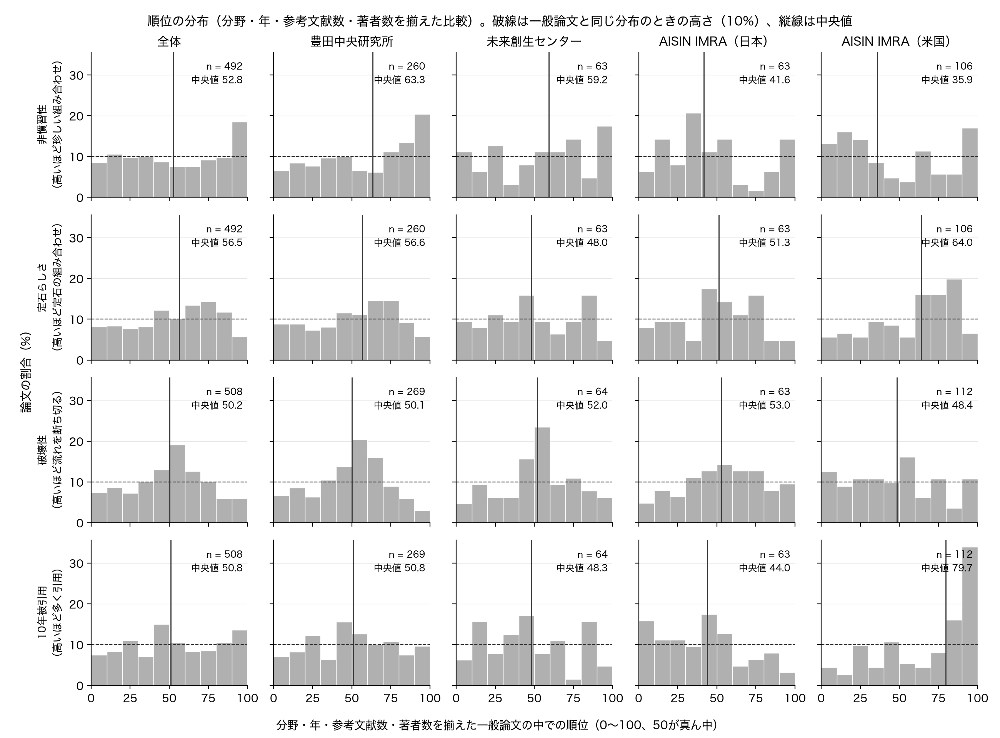
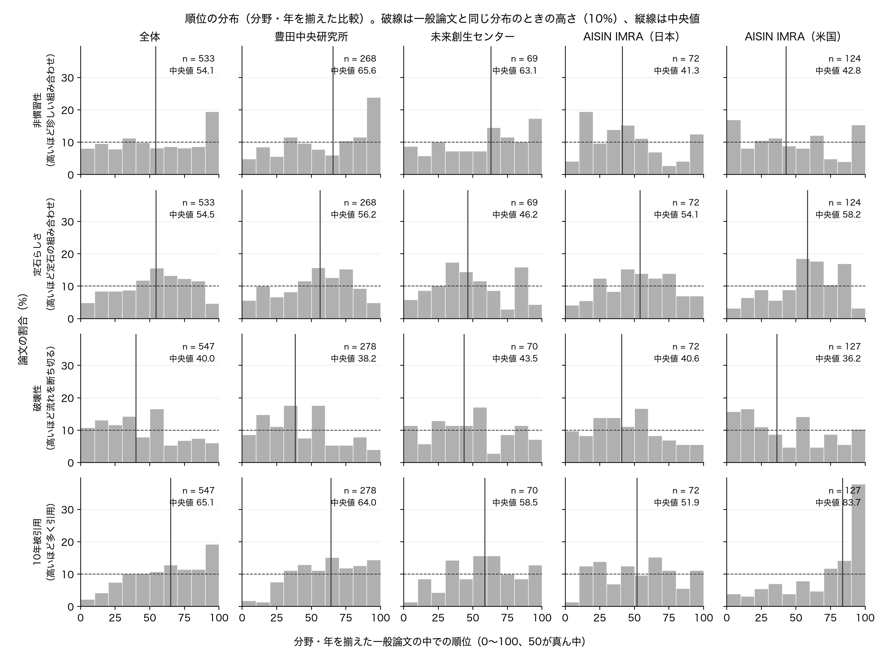
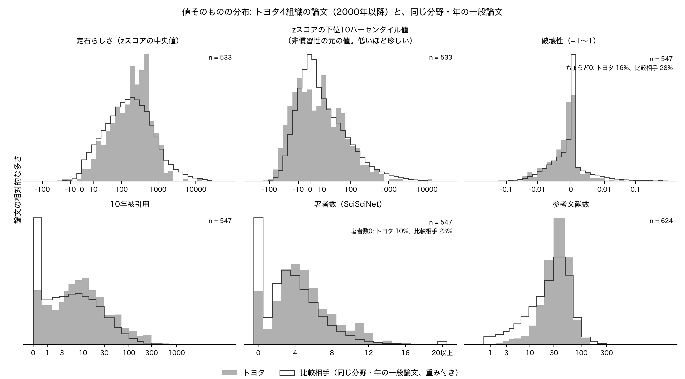
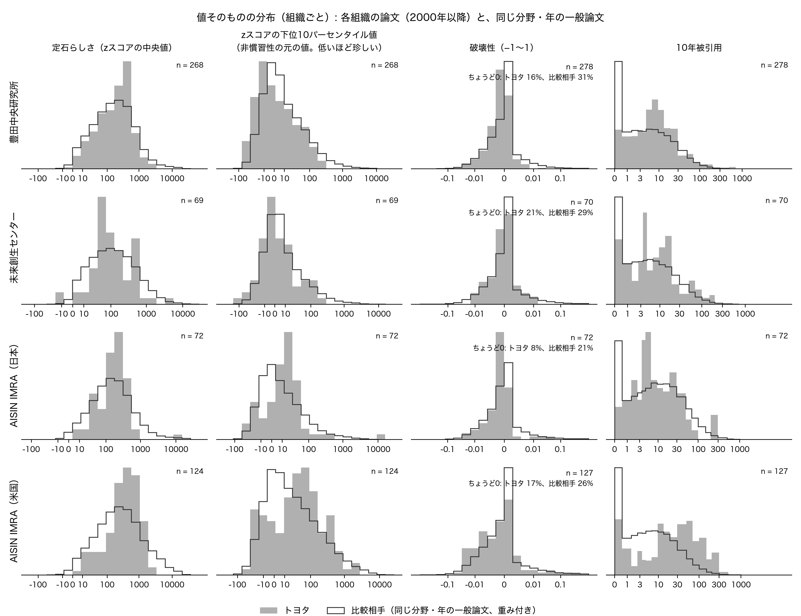

# トヨタの論文の指標の分布について

2026年10月15日　伊倉涼介

対象: 2000年以降のトヨタ関連4組織の論文 624件（9月27日改訂の分析と同じ）
比較相手: 同じ分野・同じ年の一般論文 432,000件（同じ）
使ったもの: `data/derived/analysis/paper_percentiles.csv`、`paper_analysis.csv`、`baseline_sample.csv`
描いたもの: `notebooks/analysis/novelty_distribution_plots.ipynb`。図は `figures/novelty_distributions/`

---

今井先生

9月28日の打ち合わせでご指示いただいた、指標の分布の図を作りましたのでお送りいたします。前回までの報告では全体と組織ごとの中央値だけをお示ししておりましたが、同じデータで分布そのものを描きました。新しい計算はしておらず、図に書いた中央値は9月28日の資料の数字と一致することを確かめております。

図は四つございます。一つめと二つめは順位の分布、三つめと四つめは値そのものの分布です。

## 順位の分布

順位は、その論文と同じ分野・同じ年（二つめの条件ではさらに参考文献数と著者数も近い）の一般論文の中で、何パーセントの位置にあるかを0から100で表したもので、50が真ん中です。トヨタの論文が一般論文と同じなら、順位は0から100に均等に散り、10刻みの各区間に10%ずつ入ります。図の破線がその高さで、棒が破線より高い区間に論文が偏っております。縦線は中央値です。

一つめの図は、分野・年・参考文献数・著者数を揃えた順位です（9月28日の資料8ページと同じ条件）。

読み取れることを申し上げます。

新規性（一段目の非慣習性）は、全体ではほぼ平らですが、上位10%の区間だけが突出しております（492件のうち18.5%）。全体としては世の中並みだが、特に珍しい組み合わせを使う論文が一定数ある、という形です。豊田中央研究所は右上がりで、上位の三つの区間が11%、14%、20%と増えていき、上位4分の1に39%が入ります。AISIN IMRA の米国法人は、下位30%に43%が入る一方で、上位10%の区間にも17%が入っており、二つに割れた形をしております。中央値35.9という一つの数字からは見えなかった点です。

破壊性（三段目）は、どの組織も真ん中の40〜60に山があり、両端が少なくなっております。これは、SciSciNet が引用されていない論文に破壊性0を入れており、0の論文がちょうど真ん中あたりの順位になるためです。トヨタの論文も比較相手も0の論文が多いので、山が真ん中にできます。前回「破壊性は真ん中」と申し上げたのは、この山の表れでもあります。両端に分かれる論文は多くありません。

10年被引用（四段目）は、AISIN IMRA の米国法人だけが際立っており、上位10%の区間に34%、上位4分の1に52%が入ります。他の三つの組織はおおむね平らです。

二つめの図は、分野と年だけを揃えた順位です（資料9ページの条件）。

この条件では、前回ご報告したとおり破壊性が低い側に寄り（中央値40）、10年被引用は高い側に寄ります（中央値65）。図で見ますと、破壊性は下位40%の四つの区間がいずれも10%を超え、60以上の四つの区間はいずれも10%を下回っております。50〜60の区間に17%の山があるのは、上で申し上げた破壊性0の論文です。10年被引用は下位20%の二つの区間がほとんど空で（2%と4%）、引用されない論文が世の中より少ないことが分かります。これらの片寄りは、一つめの図のとおり、参考文献数と著者数を揃えるとほぼ消えます。

## 値そのものの分布

三つめと四つめの図は、順位ではなく SciSciNet の値そのものを、トヨタの論文と比較相手の一般論文とで重ねたものです。比較相手は分野・年ごとに最大3,000件ずつ引いておりますので、そのまま重ねるとトヨタの論文が1件しかない分野・年も、100件ある分野・年と同じ重さで入ってしまいます。そこで分野・年ごとに重みを付け、分野・年の構成をトヨタの論文と同じにしてから描いております。zスコアは数千に達する論文があるため、横軸は符号を保ったまま対数的に縮めてあります（目盛りは元の値）。

この図から分かることは三つございます。

一つめ。新規性と定石らしさの値の形は、トヨタも世の中も同じ釣鐘型で、トヨタのほうが裾が少し狭くなっております。中心の位置の違いは小さく、値そのものの図からは読み取りにくいので、比較は順位の図で行うのが適切です。

二つめ。破壊性は、トヨタも世の中も、ほぼすべての論文が−0.01から0.01の間に収まっております。ちょうど0の論文は、トヨタで16%、比較相手で28%です。この指標で組織や論文の差を論じるには値の幅が小さすぎる、という点にご留意ください。

三つめ。10年被引用・著者数・参考文献数は、トヨタと世の中で形がはっきり違います。世の中の論文は10年間で一度も引用されない論文が24%ありますが、トヨタは10%です。著者数は、世の中の3人に対してトヨタは5人が真ん中で、著者数0（SciSciNet に著者の記録がない論文）も世の中の23%に対してトヨタは10%です。参考文献数は、世の中には参考文献が10本未満の論文が相当数ありますが、トヨタにはほとんどありません。前回「よく引用されるという特徴は、チームが大きく参考文献が多いことの表れ」と申し上げた点が、分布でも確認できます。

四つめの図は、同じものを組織ごとに描いたものです。

AISIN IMRA の米国法人は、新規性の元の値（zスコアの下位10パーセンタイル値）が世の中より明らかに右（珍しくない側）に寄っており、順位の図で見た「定石寄り」が値の分布からも確認できます。10年被引用も右に寄っております。豊田中央研究所と未来創生センターは、わずかに左（珍しい側）に寄っております。未来創生センターは件数が69件と少なく、定石らしさの分布に山が二つあるように見えますが、件数が少ないことによる揺れの可能性があり、ここから何かを言うことはできません。

## 留意点

- 値そのものの図では、比較相手の論文のうち zスコアが無限大になっている論文（定石らしさで2,232件、新規性で395件）を除いております。順位の図は前回の分析の表の値をそのまま使っており、影響はありません。
- 順位の図の件数は、比べる相手が30件未満の論文を除いているため、条件を増やした一つめの図のほうが少なくなっております。
- 各パネルの件数・中央値・上下4分の1の割合は `figures/novelty_distributions/rank_summary.csv` にございます。

以上、よろしくお願いいたします。
