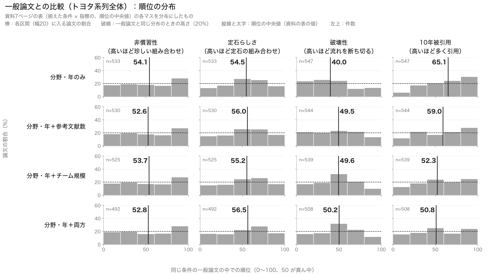
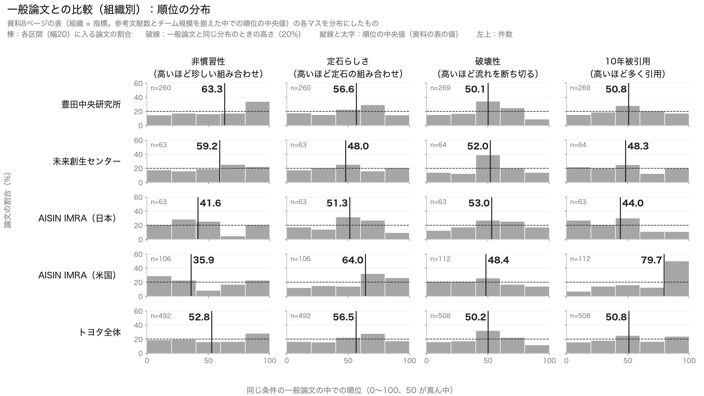
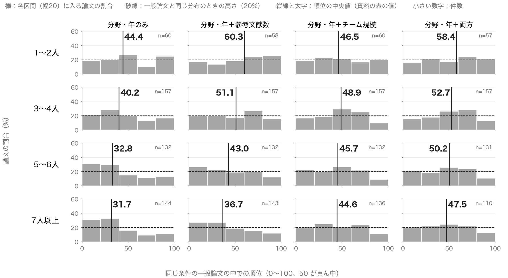
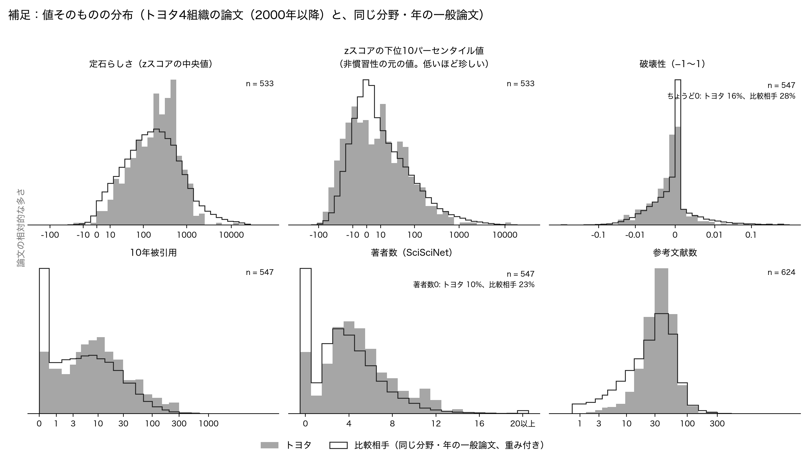

# トヨタの論文の指標の分布について

2026年10月15日　伊倉涼介

対象: 2000年以降のトヨタ関連4組織の論文 624件（9月27日改訂の分析と同じ）
比較相手: 同じ分野・同じ年の一般論文 432,000件（同じ）
使ったもの: `data/derived/analysis/paper_percentiles.csv`、`paper_analysis.csv`、`baseline_sample.csv`
描いたもの: `notebooks/analysis/novelty_distribution_plots.ipynb`。図は `figures/novelty_distributions/`

---

今井先生

9月28日の打ち合わせでご指示いただいた、指標の分布の図を作りましたのでお送りいたします。前回の資料では順位の中央値を表でお示ししましたが、その表の各マスを、中央値の代わりに分布にしたものです。図の行と列は資料の表と同じ並びにし、各マスには資料の表の中央値をそのまま書き込んであります。新しい計算はしておりません。同じ図を資料（9月28日の pptx）にも、該当する表の直後のページとして差し込んでおります。

図の見方は三つの図で共通です。順位は、その論文と同じ分野・同じ年（条件によってはさらに参考文献数と著者数も近い）の一般論文の中で何パーセントの位置にあるかを0から100で表したもので、50が真ん中です。順位を幅20の五つの区間に分け、各区間に入る論文の割合を棒で描いております。トヨタの論文が一般論文と同じなら、どの区間にも20%ずつ入りますので、その高さを破線で引いてあります。棒が破線より高い区間に論文が偏っております。縦線と太字の数字が中央値です。

## 図1　トヨタ系列全体（資料7ページの表）

行が揃えた条件、列が指標です。読み取れることを申し上げます。

非慣習性は、どの条件でも0から80までは平らで、80から100の区間だけが27〜28%と高くなっております。中央値は52〜54で真ん中ですが、「全体は世の中並みで、特に珍しい組み合わせを使う論文が上位に一定数ある」という形です。

破壊性は、分野と年だけを揃えた条件では0から60までの三つの区間が24〜26%、60以上の二つの区間が12〜14%と、低い側に寄っております。参考文献数と著者数まで揃えますと、40から60の一区間だけが32%と高く、両側は平らになります。この山は、SciSciNet が引用されていない論文に破壊性0を入れており、0の論文がちょうど真ん中あたりの順位になるためにできるものです。前回「破壊性は真ん中」と申し上げたのは、この山の表れでもあり、両端に分かれる論文は多くありません。

10年被引用は、分野と年だけを揃えた条件では右上がりで、0から20の区間が6%、80から100の区間が31%です。両方を揃えますと、どの区間も16〜25%でほぼ平らになります。前回申し上げた「よく引用されるという特徴は、チームが大きく参考文献が多いことの表れ」が、分布の形の変化として見えます。

定石らしさは、40から80の二つの区間がやや高い程度で、条件を変えてもほとんど変わりません。

## 図2　組織別（資料8ページの表）

行が組織、列が指標で、参考文献数と著者数を揃えた順位です。

非慣習性は、豊田中央研究所では80から100の区間に34%が入り、他の区間は15〜17%です。中央値63.3は、上位に偏った分布の表れです。未来創生センターは60以上の二つの区間に47%が入りますが、件数が63件と少なく、形ははっきりしません。AISIN IMRA の日本法人は20から60に多く、60から80がわずか5%です。AISIN IMRA の米国法人は、0から40の二つの区間に52%が入る一方で、80から100の区間にも23%が入っており、二つに割れた形をしております。中央値35.9という一つの数字からは見えなかった点です。

定石らしさは、AISIN IMRA の米国法人だけが60以上の二つの区間に58%と偏っており、中央値64.0に対応しております。

破壊性は、どの組織も40から60の区間だけが高く（26〜39%）、上で申し上げた破壊性0の論文の山です。

10年被引用は、AISIN IMRA の米国法人だけが80から100の区間に50%と際立っており、0から20の区間は7%です。他の三つの組織はおおむね平らです。

## 図3　チーム規模別の破壊性（資料11ページの表）

行がチーム規模、列が揃えた条件です。分野と年だけを揃えた条件では、1〜2人のチームは80から100の区間に25%が入るのに対し、7人以上では0から40の二つの区間に64%が入っており、チームが大きいほど低い側に寄っていく様子が分布で見えます。チーム規模を揃えますと、どの行もほぼ平らになり、前回の表で申し上げた「チーム規模を揃えると傾きが消える」ことが確認できます。

## 補足　値そのものの分布

資料にはない図ですが、順位にする前の SciSciNet の値そのものを、トヨタの論文（塗り）と比較相手の一般論文（線）で重ねたものを一枚付けております。比較相手は分野・年の構成をトヨタの論文と同じにする重みを付けてあります。ここから分かることは二つです。一つは、破壊性はトヨタも世の中もほぼすべての論文が−0.01から0.01の間に収まっており、ちょうど0の論文がトヨタで16%、世の中で28%あることです。この指標で組織や論文の差を論じるには、値の幅が小さすぎる点にご留意ください。もう一つは、10年間で一度も引用されない論文が世の中では24%あるのに対しトヨタは10%であること、著者数の真ん中が世の中の3人に対しトヨタは5人であること、参考文献が10本未満の論文がトヨタにはほとんどないことです。

## 留意点

- 比べる相手が30件未満の論文には順位が無いため、揃える条件を増やすと件数が少し減ります。各マスの隅の小さい数字が件数です。
- 補足の図では、比較相手のうち zスコアが無限大になっている論文（定石らしさで2,232件、非慣習性で395件）を除いております。順位の図は前回の分析の表の値をそのまま使っており、影響はありません。
- 各マスの件数・中央値・上下4分の1の割合は `figures/novelty_distributions/rank_summary.csv` にございます。

以上、よろしくお願いいたします。
